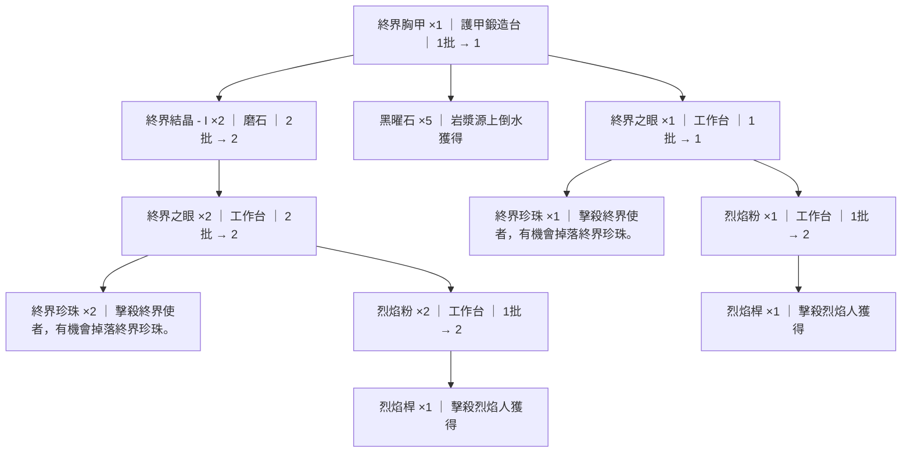

1. 裝訂機
2. 

終界胸甲 ×1

> ⚠ 缺少設備 BIO：護甲鍛造台。設備需求已列出，其建造材料尚未計算。

【配方遞歸樹】

##### 【最終基礎材料】

1. [ ] [drop] 烈焰桿 ×2 ｜ 擊殺烈焰人獲得
2. [ ] [drop] 終界珍珠 ×3 ｜ 擊殺終界使者，有機會掉落終界珍珠。
3. [ ] [item] 黑曜石 ×5 ｜ 岩漿源上倒水獲得

##### 【生產設備需求】

1. [ ] 工作台 ×1 ｜ 需建造
2. [ ] 磨石 ×1 ｜ 需建造
3. [ ] 護甲鍛造台 ×1 ｜ 未建立 / 範圍外

製作方式參照 [[#【設備製作教程】|設備製作教程]]。

##### 【設備建造所需基礎材料】

1. [ ] [item] 紅石 ×1 ｜ 於世界採集獲得
2. [ ] [drop] 線 ×3 ｜ 擊殺蜘蛛概率獲得
3. [ ] [item] 橡木原木 ×4 ｜ 砍伐天然生成的橡木原木獲得
4. [ ] [item] 鵝卵石 ×7 ｜ 於世界採集[[石頭]]獲得

【逐步製作教程】

1. [ ] 【補齊設備】補齊「護甲鍛造台」的 BIO，才能計算建造材料。
2. [ ] 【備料】準備基礎材料，參照 [[#【最終基礎材料】|最終基礎材料清單]]；取得方式與缺少 BIO 等狀態見清單。
3. [ ] 【設備】準備生產設備，參照 [[#【生產設備需求】|生產設備清單]]。
4. [ ] 【成品製作】使用「工作台」，投入 [drop] 烈焰桿 ×2，製作 2 批「烈焰粉」，每批 2，共得 4（本階段需求 3，剩餘 1）。
5. [ ] 【成品製作】使用「工作台」，投入 [drop] 終界珍珠 ×3、[item] 烈焰粉 ×3，製作 3 批「終界之眼」，每批 1，共得 3（本階段需求 3，剩餘 0）。
6. [ ] 【成品製作】使用「磨石」，投入 [item] 終界之眼 ×2，製作 2 批「終界結晶 - I」，每批 1，共得 2（本階段需求 2，剩餘 0）。
7. [ ] 【成品製作】使用「護甲鍛造台」，投入 [item] 終界結晶 - I ×2、[item] 黑曜石 ×5、[item] 終界之眼 ×1，製作 1 批「終界胸甲」，每批 1，共得 1（本階段需求 1，剩餘 0）。

##### 【設備製作教程】

###### MC 設備

1. [ ] （工作台、磨石）使用「無/從背包合成」，投入 [item] 橡木原木 ×4，製作 4 批「橡木材」，每批 4，共得 16（本階段需求 12，剩餘 4）。
2. [ ] （橡木柵欄、木棒、發射器、弓）使用「無/從背包合成」，投入 [item] 橡木材 ×4，製作 1 批「工作台」，每批 1，共得 1（本階段需求 1，剩餘 0）。
3. [ ] （磨石）使用「工作台」，投入 [item] 橡木材 ×4，製作 2 批「木棒」，每批 4，共得 8（本階段需求 5，剩餘 3）。
4. [ ] （磨石）使用「工作台」，投入 [item] 橡木材 ×4、[item] 木棒 ×2，製作 1 批「橡木柵欄」，每批 3，共得 3（本階段需求 1，剩餘 2）。
5. [ ] （磨石）使用「工作台」，投入 [item] 木棒 ×3、[drop] 線 ×3，製作 1 批「弓」，每批 1，共得 1（本階段需求 1，剩餘 0）。
6. [ ] （磨石）使用「工作台」，投入 [item] 鵝卵石 ×7、[item] 弓 ×1、[item] 紅石 ×1，製作 1 批「發射器」，每批 1，共得 1（本階段需求 1，剩餘 0）。

###### 黏液科技／SF-基礎機器(原版)

7. [ ] 使用「無/從背包合成」，投入 [item] 橡木柵欄 ×1、[item] 發射器 ×1，製作 1 批「磨石」，每批 1，共得 1（本階段需求 1，剩餘 0）。 備註：多方塊結構，依遊戲手冊的結構圖擺放。

###### 科技分類待確認

8. [ ] 準備「護甲鍛造台」×1（未建立 / 範圍外）。
